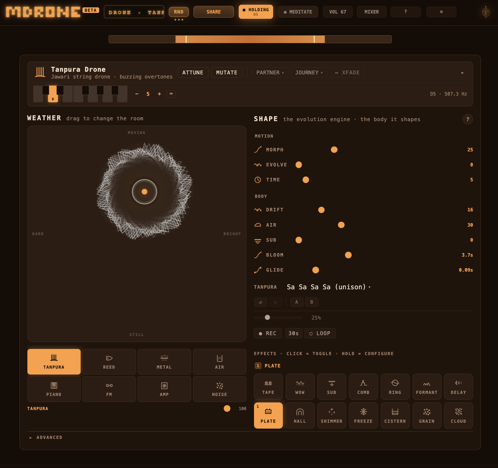

<h1 align="center">mdrone</h1>

<p align="center">
  <a href="https://github.com/gdamdam/mdrone"></a>
  <a href="https://github.com/gdamdam/mdrone/actions/workflows/ci.yml"></a>
  <a href="https://github.com/gdamdam/mdrone/blob/main/LICENSE"></a>
  
  
</p>

<p align="center"><strong>A microtonal drone instrument for the browser.</strong><br>Eight hand-authored voices, one sustained sound. Hold it for an hour on stage or in headphones.<br>No install. No account. Free.</p>

<p align="center"><a href="https://mdrone.org/">https://mdrone.org/</a></p>

<p align="center">
  
</p>

---

## Contents

- [Quick start](#quick-start)
- [What it does](#what-it-does)
- [Layout](#layout)
- [Sound](#sound) — [Voices](#voices) · [Effects](#effects) · [Mixer](#mixer)
- [Microtuning](#microtuning)
- [Motion & Evolution](#motion--evolution)
- [Visualizers](#visualizers)
- [Sessions, Links & Recording](#sessions-links--recording)
- [Keyboard, MIDI & Link](#keyboard-midi--link)
- [Accessibility & Privacy](#accessibility--privacy)
- [Under the hood](#under-the-hood) — [Audio engine](#audio-engine) · [Stability](#stability) · [Diagnostics](#diagnostics)
- [Development](#development)
- [License](#license)

---

## Quick start

1. Open **[mdrone.org](https://mdrone.org/)**.
2. Press **HOLD** (or `Space`) to start the drone.
3. Pick a **tonic** and **octave**, then drag the **WEATHER** pad (X = brightness, Y = motion).
4. Open **EDIT** for voices and effects, **ADVANCED** for tuning, Scale Editor, and LFOs.
5. **LINK** copies a shareable URL. **◆** saves the scene locally.

## What it does

- **Holds a drone** — pick a tonic and mode, layer voices, leave it on for an hour.
- **Shapes sound slowly** — six macros, two LFOs (breath + flicker), and an XY WEATHER pad.
- **Builds texture** — 8 authored voices and a 15-effect chain (plate, shimmer, freeze, hall, cistern, granular, HALO).
- **Evolves on its own** — preset morphing, seeded self-evolution, one-shot mutation, 20-minute JOURNEYs, a sympathetic PARTNER voice, gesture replay.
- **Tunes microtonally** — 26 tunings, a Scale Editor, per-interval detune, one-click ATTUNE.
- **Visualises** — 25 visualizers, inline or fullscreen MEDITATE.
- **Mixes** — master-bus drawer with EQ, glue, drive, limiter, room, width, and LUFS metering.
- **Saves and shares** — local sessions, self-contained scene links, 24-bit WAV export.
- **Works offline** — service worker + installable PWA.

## Layout

One screen, the **DRONE** instrument, in three tiers:

| Tier | Visibility | Contents |
|---|---|---|
| **Performance** | always | preset strip, HOLD / tonic / octave, WEATHER pad, six macros |
| **EDIT** | one tap | voice toggles + level sliders, FX bar |
| **ADVANCED** | one tap | tuning, Scale Editor, LFOs, fine detune, entrain |

Two surfaces slide in on demand: **◉ MEDITATE** (inline visualizer, tap to go fullscreen) and **▤ MIXER** (master-bus drawer).

The header also holds **⤓** EXPORT AUDIO, **◆** SESSION, **?** help, and **⚙** settings. **VOL** shows an `· HP` badge when headphone-safe is on.

In EDIT, each active voice tile shows a level halo, an RMS strip, and hover **M / S** chips (mute / solo). Effect tiles show a dot when AMOUNT has been changed from default.

On mobile the header collapses to two rows; help and LIVE SAFE move into Settings.

## Sound

### Voices

Eight authored models, each with its own physicality (jawari nonlinearity, soundboard coupling, bellows AM, modal bowls, cabinet shaping, noise colour).

| Voice | Character |
|---|---|
| **TANPURA** | Karplus-Strong string with jawari + auto-repluck. Unison, Sa-Pa, Sa-Ma, Sa-Ni tunings. |
| **REED** | Harmonium / shruti-box additive reed stack with bellows motion. |
| **METAL** | Inharmonic partial cloud with slow re-excitation — singing bowl, bell. |
| **AIR** | Pink-noise resonator — tuned wind, breath, open pipe. |
| **PIANO** | Long-decay felted sustain layer. |
| **FM** | Dual-operator FM with slow index drift — DX7-style bells that stay alive. |
| **AMP** | Amp / cabinet drone with oversampled drive. |
| **NOISE** | Coloured noise bed (white → brown) — tape hiss, cistern air. |

### Effects

Click to toggle, long-press for settings, drag to reorder. Each runs serial or parallel per preset.

| Effect | Character |
|---|---|
| **TAPE** | Saturation, head bump, top-end rolloff |
| **WOW** | Slow wow + faster flutter |
| **SUB** | True octave-down subharmonic |
| **COMB** | Root-tracking resonant comb |
| **RINGMOD** | Inharmonic shimmer and bell sidebands |
| **FORMANT** | Vowel formant body |
| **DELAY** | Warm feedback delay |
| **PLATE** | Convolution plate (EMT 140 IR) |
| **HALL** | FDN hall |
| **SHIMMER** | Shimmer + octave-up source |
| **FREEZE** | Phase-vocoder magnitude hold |
| **CISTERN** | Cathedral-scale FDN (~28 s tail) |
| **GRANULAR** | Drone-smooth grain cloud |
| **GRAINCLOUD** | 40 ms grain stutter, pitches snapped to scale |
| **HALO** | Multi-band harmonic-partial bloom |

### Mixer

Master-bus drawer: **HPF**, **3-band EQ**, **MUD** trim, **GLUE**, **DRIVE**, **LIMITER** (look-ahead on Chrome/Firefox, native on Safari), **WIDTH** (M/S, bass-mono under 120 Hz), **ROOM** (cathedral-IR send), **COLOR** (saturation + air), **SAFE** headphone mode, **FADE** (30 s → 20 min), **CLIP LED**, **LUFS-S + PEAK** meters, **VOL**.

Random preset picks are loudness-aware, so a string of RND clicks reads at roughly equal level.

## Microtuning

- **6 built-in tables** — 12-TET, just 5-limit, ¼-comma meantone, harmonic series, maqam rast, slendro.
- **20 authored tunings** — historical (Pythagorean, Kirnberger III, Werckmeister III, Young, Just 7-limit, Partch 11-limit), EDOs (15, 17, 19, 22, 31), world (Yaman, Pelog, Bayati), concept (Otonal 16:32, Spectral Primes, Skewed Pythagorean, Cluster 22-Sruti, Hollow), and the **mdrone Signature** just × 31-TET hybrid.
- **6 relation presets** — unison, tonic-fifth, tonic-fourth, minor triad, drone triad, harmonic stack.
- **±25 ¢ detune per interval**, live.
- **Readable intervals** — cents and, for just tunings, ratios (3/2, 5/4, 7/4…). Tap an interval to audition it. Suggested voicings apply only via **APPLY VOICING**, never automatically.
- **ATTUNE** — one-click randomize: drone-friendly tuning + relation + gentle ±2–5 ¢ detune. Disabled for 10 s after HOLD and 1.2 s after each fire so rebuilds can't stack.
- **Scale Editor** — author 13-degree tables in cents and save locally. Blocks name collisions, warns before deleting a tuning in use. Shared URLs carry the full cents array.

## Motion & Evolution

| System | Timescale | What it does |
|---|---|---|
| **MORPH** | seconds | Cross-fade time when loading a preset. 0 = snap, 1 = ~20 s. |
| **EVOLVE** | minutes | Continuous seeded drift while a preset is held. |
| **MUTATE** | instant | One-shot random perturbation, scaled by intensity. |
| **JOURNEY** | ~20 min | Authored 4-phase arc (arrival → bloom → suspension → dissolve). Four shipped: morning, evening, dusk, void. |
| **REC MOTION** | 60 s / 200 events | Records live moves into the share URL; replays on load. |

MORPH and EVOLVE are macros; the rest live in the GESTURES panel. **PARTNER** adds a sympathetic second voice at a fixed relation (fifth, octave, beat-detuned). **Undo / redo** keeps 50 steps plus two A/B slots.

## Visualizers

25 scenes in four groups, inline or fullscreen via **◉ MEDITATE**:

- **HARMONIC** — pitch / phase / beat scenes (phase portrait, vectorscope, tonnetz, harmonic ember…).
- **LANDSCAPE** — slow accreting fields (petroglyphs, sediment strata, prayer rug, tape decay).
- **RITUAL** — ornate and painterly (iron filings, cymatics, crystal lattice, Rothko field).
- **VOID · HYPNOTIC** — minimal or stroboscopic (void monolith, moiré, feedback tunnel, dream machine — *10 Hz flicker, warning shown*).

Slow time, matte material, accrete over minutes rather than react per frame.

## Sessions, Links & Recording

**Sessions** — **◆** saves named scenes to `localStorage` (save / load / rename, plus JSON import / export). A session holds everything: tuning, voices, macros, LFOs, effects, mixer, evolve seed, journey, partner, and motion recording.

**Scene links** — **LINK** copies a self-contained URL. Shortened via `s.mdrone.org`, with the long URL as fallback. Open it anywhere, press Play, and you are back in the same drone. The share modal warns past ~1900 characters, since some platforms truncate.

**⤓ EXPORT AUDIO** — captures the post-limiter master to 24-bit stereo WAV, bit-identical. Auto-starts HOLD, warns before you close a tab mid-take, names files with scene, tonic, octave, and preset.

| Mode | What you get |
|---|---|
| **REC LIVE** | Open-ended take. Recommended max 15 min (~22 MB/min in memory; staged warnings). |
| **BOUNCE LOOP** | Seamless loop (15 / 30 / 60 s) with crossfade and a `smpl` chunk for samplers. |
| **TIMED REC** | Fixed-length realtime take (30 s · 1 m · 3 m · 10 m), auto-stops and downloads. |

**REC MOTION** is different: it records gestures, not audio, and travels inside the share link.

## Keyboard, MIDI & Link

**Keyboard** — toggle `⌨`, then pick a mode:

- **TONIC** — `A W S E D F T G Y H U J` set the root. `Z` / `X` shift the drone octave.
- **PLAY** — `A … K` play scale degrees above the tonic, snapped to the tuning. Tap to hold, tap again to release, up to six notes. `Z` / `X` pick the register for the *next* note (`8VA ±N`). Played notes never persist into scenes or links.

Always on: `Space` HOLD · `Cmd/Ctrl+Z` / `Shift+Z` undo / redo · `<` / `>` previous / next preset.

**MIDI** (desktop) — note-in sets tonic + octave. The **MIDI ▾** menu has an Ableton-style **LEARN MODE** and a **MAPPING…** modal with templates and JSON import / export. ~52 targets, multiple CCs per target. Defaults: CC1 WEATHER Y, CC2 WEATHER X, CC7 VOL, CC64 HOLD, CC71–76 the six macros.

**Ableton Link** — the breathing LFO syncs to Link tempo (FREE, 8/1 … 1/16) and phase-locks its peak to the downbeat. Optional **Quantize changes to Link grid** (Settings → tempo, off by default) defers root, chord, preset, and start to the next beat or bar. Requires mpump's [Link Bridge](https://github.com/gdamdam/mpump/releases), a small local companion. Nothing leaves your machine.

**mbus** — Settings → **BUS** publishes the master output to the [mbus](https://mbus.mpump.live) patchbay as `mdrone`, tab-to-tab over WebRTC via the same bridge. Off by default, never persisted.

## Accessibility & Privacy

- **Reduced motion honoured** — the DREAM MACHINE strobe becomes a slow breath; decorative loops are muted. Audio is unaffected.
- **Screen-reader labels** on every icon button and canvas.
- **44 × 44 touch targets** on touch devices.
- **Low-Power Mode** (Settings → GENERAL) — 15 fps visualizer, 5 Hz meter, no preset-change duck. For older or weaker machines.
- **Error boundary** — one broken panel can't blank the app.

No accounts, cookies, ads, fingerprinting, or third-party trackers. Sessions, tunings, and recordings stay on your device. Anonymous page-view counts via [GoatCounter](https://goatcounter.com); DNT disables them. Hosted on GitHub Pages.

---

## Under the hood

### Audio engine

Everything is synthesised live with Web Audio + AudioWorklet. No samples for voices.

- **Voices** — one worklet voice per interval, mixed through per-layer gains. Tonic changes glide; interval changes crossfade. Each voice has a sub-Hz pitch-drift LFO and its own stereo position.
- **Climate** — WEATHER X drives brightness, Y drives motion. A breathing LFO modulates gain; a FLICKER LFO (0.5–45 Hz) phase-locks to it for AM or dichotic L/R detune.
- **Effects** — 15, drag-reorderable, serial or parallel per preset.
- **Master bus** — HPF, EQ, mud trim, glue, drive, cathedral-IR room, color + air, look-ahead limiter (native compression on Safari), bass-mono fold, M/S width, loudness leveling, analyser taps.
- **Reverbs** — PLATE uses a real EMT 140 IR (Greg Hopkins, CC-BY). HALL and CISTERN are FDN worklets. ROOM uses a recording of Saint-Lawrence Church, Molenbeek-Wersbeek (public domain).
- **Determinism** — IR seeds and evolve drift derive from a per-scene PRNG (FNV-1a of preset ID or share seed). Same URL, same tail.
- **Recording** — a dedicated worklet tap captures the post-limiter master to 24-bit WAV.

### Stability

Three layers keep audio steady on stage.

**Adaptive stability** (automatic) — when the audio thread struggles for a sustained period, the engine steps down in three stages, each with a cooldown:

1. **Visuals** — low-power overlay (visualizer fps, meter rate).
2. **Heavy FX** — shimmer / granular / graincloud / halo bypassed. Tiles stay ON with a striped cue, so your intent is preserved.
3. **Voice density** — cap drops 7 → 4 → 3, restored on recovery.

Mitigation is fast (~9 s). Recovery is slow (~20 s plus a 30 s clean window) and unwinds one stage at a time. Scenes, links, and settings are never mutated.

**LIVE SAFE** (manual) — header pill on desktop, Settings → GENERAL on mobile. Caps voices at 4, bypasses the heaviest FX, engages low-power visuals. Steady red-orange when on. Changes you make while active win on disable. Presets carry a derived `low | medium | high` stage-risk rating.

**Headphone-safe** — Settings → GENERAL or the **SAFE** strip in the Mixer. Caps output at ~50% and shows `· HP` on VOL. Persisted.

### Diagnostics

- **Copy Audio Report** — tap the CPU warning for a modal with **COPY AUDIO REPORT**: browser, AudioContext, load monitor, adaptive + LIVE SAFE state, FX intent vs effective, mixer state. Also `await __mdroneAudioReport()` in the console. No scene data, session names, or custom tunings are included.
- **Trace** — load with `?audio-debug=trace` for a 512-event ring buffer. Underruns auto-dump it; `__mdroneDumpTrace()` dumps manually. Bypass flags (`?audio-debug=no-fx`, `no-master`, `no-limiter`, `no-glue`, `no-eq`) isolate a DSP stage.
- **NaN diagnostics** — if a voice worklet ever clamps non-finite state, the console logs `[mdrone:nan-diag] voice=<type> …`. Silence means the engine is clean.
- **Preset certification** — `window.__presetCert` (debug mode) steps through every preset with an enforced listening window and exports Markdown or JSON. `npm run audit:certify` merges it with the offline audit into `tmp/preset-certification.md`.

---

## Development

**Source layout**

| Path | Contents |
|---|---|
| `src/components/` | React UI |
| `src/engine/` | audio engine, voices, FX, worklets, presets, MIDI |
| `src/scene/` | scene model, share / snapshot codec |
| `src/microtuning.ts` | tuning tables + custom registry |
| `src/transport/mbus/` | vendored mbus client |
| `scripts/` | worklet bundle, doc + version generators |
| `tests/` | node:test suites |

**Scripts**

```
npm run dev              # Vite dev server
npm run build            # production bundle
npm run test             # all suites (also test:unit, test:e2e)
npm run test:e2e:all     # cross-browser
npm run test:e2e:long    # long-hold audio burn-in
npm run audit:presets    # offline LUFS / peak / band energy per preset
npm run audit:certify    # merge offline audit + runtime cert into one report
npm run docs:params      # generate docs/parameters.md (gitignored)
```

**Debug mode** — append `?debug` to the URL or run `localStorage.setItem("mdrone-debug", "1")` and reload. Exposes `__engine`, `__measureAllPresets`, `__auditArrival`, `__presetCert` on `window`.

**CI** — every push to `main` and every PR runs lint, typecheck, node tests, vitest, Playwright E2E, and build.

**Releases** — tag-gated. Pushing to `main` checks but never deploys.

```
npm run release           # bumps patch (or: release minor | major | X.Y.Z), regenerates CHANGELOG.md
git commit -m "X.Y.Z — release: <summary>"
git tag vX.Y.Z
git push origin main --tags
```

The tag push triggers the deploy workflow, which re-runs lint, typecheck, unit tests, and build, then publishes `dist/` to `gh-pages`. `npm run deploy` remains as a manual escape hatch.

---

## License

[AGPL-3.0](LICENSE)

"mdrone" is an unregistered trademark of the author. Use of the name or logo for derivative projects or services is not permitted.

Built with Claude Code. Design, architecture, UX, audio chain, and creative direction by [gdamdam](https://github.com/gdamdam).
